# ISPAD v2 (Mitigata)
### Identity Security & Posture Anomaly Detection (ITDR) Platform

[](tests/)
[](pyproject.toml)
[](frontend/)
[](docs/ARCHITECTURE_CURRENT.md)
[-success.svg)](reports/redteam.md)

---

## 🚀 Overview

**ISPAD v2** is an enterprise-grade **Identity Threat Detection and Response (ITDR)** platform designed to eliminate identity sprawl, detect stealthy credential abuse, and cut through alert fatigue.

Traditional Identity and Access Management (IAM) tools generate hundreds of low-context alerts. ISPAD v2 replaces alert fatigue with an **adversarial dual-LLM adjudication engine**, a **schema-agnostic ingestion pipeline**, **multi-source identity resolution**, **graph-based attack path modeling**, **automated remediation playbooks**, and **continuous compliance auditing** (SOC 2, ISO 27001, NIST CSF) — all fortified with a **hardened AI security perimeter**.

---

## 🏆 Key Benchmark Highlights (vs Legacy Baseline)

| Capability / Benchmark | Baseline (Legacy Prototype) | ISPAD v2 (Ours) | Real-World Impact |
| :--- | :--- | :--- | :--- |
| **Devil's Advocate FP Suppression** | 0% reduction (9 alerts, 5 FP) | **80.0% FP Reduction** (5 alerts, 1 FP) | F₁ Score improved from **0.615 $\to$ 0.889** |
| **Malicious Attacks Wrongly Dismissed**| Vulnerable to hallucination | **Strictly ZERO (0)** | 100% security invariant on true attacks |
| **Detection Quality (F₁ Score)** | 0.518 (single-schema baseline) | **0.789 (+0.271 improvement)** | Generalized 13-feature canonical core |
| **Adversarial Prompt Injection Defense**| 100.0% Attack Success Rate (ASR) | **0.0% Defended ASR** (32/32 blocked) | Zero-trust sanitization, nonces & threat redaction |
| **Benign Data Redaction False Positives**| N/A | **0.0% False Positives** | Tested across 100 benign corporate roles |
| **Automated Verification Gate** | No unit test suite | **96 / 96 Pytest Tests Passing** | 100% automated coverage across all 8 phases |
| **Legacy Column Invariant** | Hardcoded legacy column names | **0 Leaks** across active modules | Complete schema decoupling |

---

## 🏗️ High-Level System Architecture

```mermaid
flowchart TD
    subgraph DataSources["Data Sources (CSV, JSON, JSONL, Parquet)"]
        S1["HR Systems (Workday, BambooHR)"]
        S2["IdP / SSO (Okta, Azure AD)"]
        S3["Cloud Audit (AWS CloudTrail, GCP)"]
        S4["Custom Logs & Entitlements"]
    end

    subgraph Phase1["1. Ingestion & Profiling"]
        R["Format Readers (CSV, JSON, Parquet)"]
        P["DSL Profiler & Type Inferrer"]
        M["Hybrid Mapper (Heuristic + LLM)"]
        T["Transform Engine (10+ DSL transforms)"]
    end

    subgraph Phase2["2. Identity Resolution"]
        B["Blocking Engine"]
        Match["Fuzzy Matching (Jaro-Winkler + Jaccard)"]
        Cluster["Disjoint-Set Connected Components"]
        Classify["Identity Classifier (Human, Bot, NHI)"]
    end

    subgraph Phase3["3. Generalized Detection Core"]
        F["13 Canonical Features"]
        IF["Self-Calibrating Isolation Forest"]
        PC["Hierarchical Peer Cohorts (dept/title)"]
        SoD["Separation of Duties (SoD Matrix)"]
    end

    subgraph Phase7["7. AI Security Gateway"]
        San["NFKC Normalizer & BiDi Stripper"]
        Inj["Prompt Injection & Threat Detector"]
        Pii["Pseudonymization & Cryptographic Nonces"]
    end

    subgraph Phase4["4. Adversarial Dual-LLM Adjudication"]
        Pros["Prosecutor (Builds Indictment)"]
        DA["Devil's Advocate (Mitigating Hypotheses)"]
        Adj["Adjudicator (Deterministic Severity Synthesis)"]
        Inv["Verdict Invariance Enforcer"]
    end

    subgraph GraphPhase["5. Identity Graph Analytics"]
        IG["NetworkX Multi-Layer Identity Graph"]
        Paths["Dijkstra Shortest Attack Paths"]
        Blast["Blast Radius Reachability Engine"]
        Toxic["Toxic Combinations & Cycles Detector"]
        WhatIf["What-If Remediation Simulation"]
    end

    subgraph Operations["6 & 8. Governance & Ops"]
        Rem["Remediation Playbooks & Approvals"]
        Comp["Posture & Compliance (SOC 2, ISO, NIST)"]
        Audit["Tamper-Evident Audit Trail"]
    end

    subgraph Frontend["Modern Command Center Dashboard"]
        UI["10 React Views (Vite + Tailwind CSS + Lucide + D3)"]
    end

    DataSources --> Phase1
    Phase1 --> Phase2
    Phase2 --> Phase3
    Phase3 --> Phase7
    Phase7 --> Phase4
    Phase3 --> GraphPhase
    Phase4 --> Operations
    GraphPhase --> Operations
    Operations --> Frontend
    Phase1 -.-> Frontend
    Phase2 -.-> Frontend
```



---

## 🧩 Core Capabilities & Features

### 1. Ingestion & Smart Schema Mapping
- **Multi-Format Support**: Native high-speed ingest for CSV, JSON, JSONL, and Apache Parquet.
- **Hybrid Schema Mapper**:
  - **Tier 1**: Exact canonical match.
  - **Tier 2**: Curated synonym dictionary (`backend/ingest/synonyms.yaml`).
  - **Tier 3**: Regex pattern, date format, and type-similarity heuristics.
  - **LLM Semantic Fallback**: Automatically requests semantic mapping suggestions for ambiguous enterprise columns.
- **Data Transformation DSL**: Ingest-time pipeline for field standardization (`split`, `strip`, `lower`, `upper`, `regex_replace`, `coalesce`, `derive_field`, etc.).
- **Interactive Feedback Loop**: Remembers user column adjustments in the SQLite `mapping_feedback` table for lifelong learning.

### 2. Identity Resolution & Entity Clustering
- **Multi-System Stitching**: Merges fractured identities (e.g., `jdoe` in Okta, `john.doe@company.com` in Workday, `arn:aws:iam::123:user/jdoe-admin` in AWS).
- **4-Stage Pipeline**:
  1. **Blocking**: Buckets candidate pairs by domain, soundex, or department to avoid $O(n^2)$ explosion.
  2. **Scoring**: Weighted composite score via Jaro-Winkler string similarity and entitlement Jaccard index.
  3. **Clustering**: Disjoint-Set (Union-Find) connected components with confidence scoring (High/Medium/Low).
  4. **Classification**: Classifies entities into `human_employee`, `contractor`, `service_account`, `bot`, or `shared_account`.
- **Merge/Split Review**: Interactive UI for operators to inspect, confirm, or split ambiguous identity clusters.

### 3. Generalized Anomaly Detection Core
- **13 Canonical Features**:
  `after_hours_ratio`, `weekend_ratio`, `sensitivity_ratio`, `distinct_systems`, `inactivity_days`, `history_zscore`, `failed_login_ratio`, `new_system_access_rate`, `impossible_travel_flag`, `burst_access_count`, `privileged_action_ratio`, `unused_entitlement_ratio`, and `entitlement_vs_peer_median`.
- **Graceful Degradation**: Auto-skips missing attributes without throwing runtime exceptions; logs explicit reasons.
- **Self-Calibrating Isolation Forest**: Automatically determines the anomaly contamination rate based on score distribution curvature/knee.
- **Hierarchical Peer Cohort Analysis**: Evaluates activity against `department -> job_title` cohorts with statistical roll-up and KMeans/Jaccard fallback.
- **Separation of Duties (SoD)**: Evaluates 7 production policy rules (Procurement & Payment, Code & Deploy, Access & Audit, Provisioning, Trading & Settlement, Billing & Refunds, Admin & Export) via `config/sod.yaml`.

### 4. Adversarial Dual-LLM Adjudication
- **Prosecutor**: Builds a structured indictment referencing specific anomalous events, policy infractions, and risk metrics.
- **Devil's Advocate**: Acts as defense counsel, investigating mitigating context (approved Jira tickets, active PagerDuty on-call shifts, approved leave, maintenance windows).
- **Adjudicator**: Produces an objective, auditable final verdict, determining whether to dismiss, downgrade, or escalate the case.
- **Multi-Provider LLM Gateway**:
  - **Groq API**: High-speed cloud LLMs (Llama 3 70B, Mixtral).
  - **Ollama**: Local air-gapped inference (`qwen3:8b`, `llama3`).
  - **LM Studio**: Local OpenAI-compatible server (`localhost:1234`).
  - **Mock / Replay Mode**: Deterministic disk-cached responses (`LLM_REPLAY_ONLY=true`) for offline development and instant CI testing.

### 5. Identity Graph & Attack Path Analytics
- **Multi-Layer Graph Schema**: Models `User -> Account -> Entitlement -> Resource -> Session` relationships using NetworkX.
- **Dijkstra Shortest Attack Path**: Identifies the fewest steps an adversary needs to move laterally from a compromised account to crown-jewel assets.
- **Blast Radius Reachability**: Quantifies downstream blast radius impact if an identity is breached.
- **Toxic Combinations & Cycles**: Detects toxic permission pairs, circular delegation loops, and privilege creep.
- **What-If Simulation Engine**: Allows security engineers to preview risk score reduction before revoking an entitlement.

### 6. Actionable Remediation & Playbook Approvals
- **Automated Playbook Generation**: Automatically creates step-by-step remediation plans tailored to each incident:
  - Revoke active sessions / force password reset.
  - Prune unused / stale privileges.
  - Enforce hardware MFA / Step-up authentication.
  - Quarantine account / disable service key.
  - Assign custodian to orphaned accounts.
- **Auditable Approval Workflow**: `draft` $\to$ `pending_approval` $\to$ `approved` $\to$ `executed` / `rejected`.
- **Ready-to-Run CLI Rollback Scripts**: Generates executable shell/PowerShell rollback commands and immutable JSON audit records.

### 7. Posture & Compliance Engine
- **Multi-Framework Mapping**: Audits 15 security controls across:
  - **SOC 2 Type II** (CC6.1, CC6.2, CC6.3)
  - **ISO/IEC 27001:2022** (A.9.2.1, A.9.2.3, A.9.2.6, A.9.4.2)
  - **NIST CSF v2.0** (PR.AC-1, PR.AC-4, PR.AC-6, PR.DS-5)
- **Automated Compliance Scoring**: Computes overall posture grade (0–100%) and categorizes controls into Passing, Warning, or Critical.
- **One-Click Audit Export**: Exports full compliance audit packages in JSON and Markdown formats for external auditors.

### 8. AI Security & Non-Human Identity (NHI) Governance
- **Defended against OWASP Top 10 for LLMs**:
  - **Prompt Injections & Role Hijacking**: Intercepts `[SYSTEM]` directives, instruction overrides, and delimiters.
  - **Unicode & BiDi Obfuscation**: NFKC normalization, strips zero-width spaces (`\u200b`, `\ufeff`) and right-to-left override markers (`\u202e`).
  - **Markdown Exfiltration Protection**: Strips markdown image tags, tracking beacons, raw external URLs, and HTML tags.
  - **Cryptographic Nonce Enclosure**: Wraps untrusted data inside tamper-evident cryptographic nonce blocks (`<data nonce="...">`).
  - **Data Pseudonymization**: Hashes PII and internal identifiers (`USER_0042`) before LLM inference.
  - **Verdict Invariance Guarantee**: Security assertion prohibiting the model from demoting severity if untrusted input contains injection patterns.
- **Non-Human Identity (NHI) Governance**:
  - Dedicated auditing of service accounts, CI/CD runners, and API keys.
  - Flags orphaned credentials lacking human custodians, dormant keys $> 90$ days, and service accounts performing interactive GUI logins.

---

## 🖥️ Command Center Frontend (10 Views)

| Route | View Name | Description |
| :--- | :--- | :--- |
| `/` | **Alerts & Risk Table** | Real-time threat feed, risk scores, peer status, and quick triage filters. |
| `/connect` | **Data Ingestion** | Upload CSV, JSON, JSONL, Parquet files with auto-detection. |
| `/mapping` | **Schema Mapping** | Interactive column mapper, confidence badges, and transform builder. |
| `/unified-schema` | **Unified Schema** | Master canonical dictionary, custom fields, and validation rules. |
| `/resolution` | **Identity Resolution** | Review clustered accounts, entity merge/split, and confidence review. |
| `/case/:id` | **Case Investigation** | Deep-dive case view, Prosecutor vs Devil's Advocate transcript & timeline. |
| `/graph` | **Identity Graph** | Interactive D3 force-directed attack graph, blast radius & What-If simulator. |
| `/remediation` | **Remediation Center** | Playbook execution, approval states, CLI script downloads & audit logs. |
| `/compliance` | **Posture & Compliance** | SOC 2 / ISO / NIST compliance scorecards and auditor report generator. |
| `/ai-security` | **AI Security & NHI** | Live prompt injection tester, red-team metrics, and NHI governance table. |

---

## 📁 Repository Structure

```
ISPAD/
├── backend/                        # FastAPI Backend Application
│   ├── api/                        # REST API Routers
│   │   ├── detect.py               # Detection & anomaly endpoints
│   │   ├── graph.py                # Graph analytics & What-If endpoints
│   │   ├── investigate.py          # Dual-LLM investigation & adjudication
│   │   ├── posture.py              # Compliance & posture scorecards
│   │   ├── remediation.py          # Remediation playbooks & approvals
│   │   ├── resolution.py           # Identity resolution & clustering
│   │   ├── schema.py               # Unified schema & transformation DSL
│   │   ├── security.py             # AI security & NHI endpoints
│   │   └── sources.py              # Multi-source file uploads & profiling
│   ├── core/                       # Core database, models & audit logger
│   │   ├── audit.py                # Append-only audit logger
│   │   ├── db.py                   # SQLite engine & table schemas
│   │   └── models.py               # Canonical Pydantic schemas
│   ├── detect/                     # Anomaly detection engine
│   │   ├── features.py             # 13 canonical behavioral features
│   │   ├── heuristics.py           # Stale accounts, privilege creep & SoD
│   │   ├── peers.py                # Peer cohort statistics & clustering
│   │   └── scoring.py              # Self-calibrating Isolation Forest & fusion
│   ├── graph/                      # Attack path & blast radius analytics
│   │   ├── blast.py                # Blast radius reachability
│   │   ├── build.py                # NetworkX multi-layer graph builder
│   │   ├── paths.py                # Shortest attack paths (Dijkstra)
│   │   ├── toxic.py                # Toxic combinations & cycles
│   │   └── whatif.py               # What-If entitlement revocation simulation
│   ├── ingest/                     # Ingestion & schema mapping
│   │   ├── dsl.py                  # Transformation DSL
│   │   ├── heuristic_mapper.py     # 3-tier heuristic column mapper
│   │   ├── legacy_adapter.py       # Legacy dataset compatibility seam
│   │   ├── llm_mapper.py           # LLM semantic mapping fallback
│   │   ├── profiler.py             # Data profiling & column inference
│   │   ├── readers.py              # Multi-format file readers
│   │   ├── schema_editor.py        # Schema configuration manager
│   │   └── unified_schema.py       # Canonical unified schema definition
│   ├── llm/                        # Dual-LLM Adjudication
│   │   ├── adjudicator.py          # Final verdict synthesizer
│   │   ├── devils_advocate.py      # Defense counsel agent
│   │   ├── gateway.py              # Multi-provider LLM gateway & cache
│   │   ├── investigate.py          # Investigation orchestration
│   │   ├── prosecutor.py           # Prosecution indictment agent
│   │   └── tools.py                # Context retrieval tools (Tickets, Leave, etc.)
│   ├── posture/                    # Compliance & Posture Engine
│   │   ├── compliance.py           # Multi-framework compliance checker
│   │   ├── controls.yaml           # SOC 2 / ISO 27001 / NIST control rules
│   │   ├── report.py               # JSON/Markdown auditor report generator
│   │   └── score.py                # Posture grade calculator
│   ├── remediation/                # Remediation playbooks & approvals
│   │   ├── approvals.py            # Approval state machine & rollback scripts
│   │   └── plan.py                 # Automated action plan generator
│   ├── resolve/                    # Identity Resolution Engine
│   │   ├── blocking.py             # Candidate pair blocking
│   │   ├── classify.py             # Human vs Non-Human classification
│   │   ├── cluster.py              # Disjoint-set graph clustering
│   │   ├── engine.py               # End-to-end resolution pipeline
│   │   ├── match.py                # Fuzzy string & Jaccard matching
│   │   └── normalize.py            # Username & email normalizer
│   ├── security/                   # AI Security Hardening
│   │   ├── injection_detect.py     # Threat & prompt injection detection
│   │   ├── invariance.py           # Verdict invariance safety check
│   │   ├── nhi.py                  # Non-human identity governance auditor
│   │   ├── pseudonymize.py         # PII pseudonymizer & nonce generator
│   │   └── sanitize.py             # NFKC normalizer & BiDi stripper
│   ├── config.py                   # Central environment configuration
│   └── main.py                     # FastAPI application entrypoint
├── frontend/                       # Vite + React Frontend Application
│   ├── src/
│   │   ├── components/             # Reusable UI components (RiskTable, UserCard, etc.)
│   │   ├── pages/                  # 10 Command Center Page Views
│   │   ├── api.js                  # Frontend API client
│   │   ├── App.jsx                 # Main application router & layout
│   │   └── styles.css              # Dark-mode command center styling
│   ├── package.json
│   └── vite.config.js
├── config/                         # Configuration definitions
│   └── sod.yaml                    # Separation of Duties policy matrix
├── data/                           # Data storage & synthetic datasets
│   └── synthetic/                  # Multi-source test datasets (B, C, D & Org Context)
├── docs/                           # Architecture & threat models
│   ├── ARCHITECTURE_CURRENT.md     # In-depth architectural design
│   └── THREAT_MODEL.md             # Formal security threat model
├── reports/                        # Verification & Benchmark Reports
│   ├── da_ablation.md              # Devil's Advocate ablation study
│   ├── detection.md                # Multi-schema detection benchmarks
│   ├── mapping.md                  # Ingest & mapping evaluation
│   ├── redteam.md                  # 32-payload adversarial red-team results
│   └── resolution.md               # Identity resolution benchmarks
├── scripts/                        # Benchmarking & dataset generation scripts
│   ├── bench_da_ablation.py        # DA false-positive ablation benchmark
│   ├── bench_detection.py          # Detection quality benchmark
│   ├── bench_mapping.py            # Schema mapping benchmark
│   ├── bench_redteam.py            # Adversarial injection benchmark
│   ├── bench_resolution.py         # Entity resolution benchmark
│   └── gen_datasets.py             # Synthetic enterprise data generator
├── tests/                          # Automated Pytest Suite (96 Tests)
│   ├── test_ai_security.py         # Injection, sanitization & invariance tests
│   ├── test_column_literals.py     # Schema decoupling & zero-leak invariant
│   ├── test_compliance.py          # Compliance & posture tests
│   ├── test_da.py                  # Dual-LLM Devil's Advocate tests
│   ├── test_detect.py              # Detection core & SoD tests
│   ├── test_graph.py               # Graph analytics & What-If tests
│   ├── test_legacy_seam.py         # Legacy prototype adapter seam tests
│   ├── test_mapper.py              # Schema mapper tests
│   ├── test_nhi.py                 # Non-Human Identity governance tests
│   ├── test_prompt_leak.py         # Zero PII/excluded fields LLM leak test
│   ├── test_readers_profiler.py    # File format readers & profiler tests
│   ├── test_remediation.py         # Playbook generation & approval tests
│   ├── test_resolution.py          # Identity resolution pipeline tests
│   ├── test_transforms_dsl.py      # Ingest DSL transformation tests
│   └── test_unified_schema.py      # Unified canonical schema tests
├── .env.example                    # Template environment variables
├── check.ps1                       # Automated verification script (Windows)
├── Makefile                        # Automated verification Makefile (Unix/macOS)
├── pyproject.toml                  # Ruff linter & Pytest configuration
├── requirements.txt                # Unified root Python dependencies
└── THIRD_PARTY.md                  # Open-source license disclosures
```

---

## ⚡ Quickstart Guide (For Teammates)

### 1. Prerequisites
- **Python 3.10+** (Python 3.11 recommended)
- **Node.js 18+** & `npm`
- **Git**

---

### 2. Clone and Setup Environment

```bash
# Clone the repository
git clone https://github.com/Jival-Raghav/mitigata.git
cd mitigata

# Create and activate Python virtual environment
# Windows PowerShell:
python -m venv .venv
.\.venv\Scripts\Activate.ps1

# Linux / macOS:
python3 -m venv .venv
source .venv/bin/activate
```

---

### 3. Install Dependencies

```bash
# Install Python backend dependencies
pip install --upgrade pip
pip install -r backend/requirements.txt
pip install -r requirements.txt

# Install Frontend dependencies
cd frontend
npm install
cd ..
```

---

### 4. Configure Environment Variables

Copy `.env.example` to create your local `.env`:

```bash
# Windows PowerShell:
Copy-Item .env.example .env

# Linux / macOS:
cp .env.example .env
```

Edit `.env` to configure your preferred LLM provider:

```env
# Mode 1: Fast Cloud API via Groq (Recommended for testing without local GPU)
PROSECUTOR_PROVIDER=groq
DA_PROVIDER=groq
GROQ_API_KEY=your_groq_api_key_here
GROQ_MODEL=llama3-70b-8192

# Mode 2: Local LLMs via Ollama & LM Studio
# PROSECUTOR_PROVIDER=lmstudio
# DA_PROVIDER=ollama
# LMSTUDIO_BASE_URL=http://localhost:1234/v1
# OLLAMA_BASE_URL=http://localhost:11434

# Mode 3: Instant Offline Development (Zero API Keys required)
# LLM_REPLAY_ONLY=true
```

> **Tip**: If you do not have an API key or local models running, set `LLM_REPLAY_ONLY=true`. The system will automatically use deterministic disk-cached responses and allow you to test every feature instantly!

---

### 5. Run Verification & Quality Gates

Ensure everything is healthy before making changes:

```bash
# Run all 96 automated tests
pytest tests/ -v

# Run the Ruff code linter
ruff check .

# Verify the legacy column-name invariant (zero raw legacy headers outside ingest)
pytest tests/test_column_literals.py -v

# Full quality gate check script:
# Windows:
.\check.ps1

# Linux / macOS:
make check
```

---

### 6. Launch the Application

Start both backend and frontend servers:

#### Terminal 1 — Backend (FastAPI):
```bash
# From repository root (with .venv active):
uvicorn backend.main:app --host 0.0.0.0 --port 8000 --reload
```
- API Documentation (Swagger UI): **http://localhost:8000/docs**
- Healthcheck: **http://localhost:8000/api/health**

#### Terminal 2 — Frontend (React + Vite):
```bash
cd frontend
npm run dev
```
- Web Application: **http://localhost:5173**

---

## 🔬 Benchmark & Evaluation Scripts

Run our benchmark scripts to reproduce all research metrics:

```bash
# 1. Devil's Advocate False-Positive Ablation Study
python scripts/bench_da_ablation.py

# 2. Multi-Schema Anomaly Detection Benchmark
python scripts/bench_detection.py

# 3. Adversarial Red-Team Injection Benchmark (32 Payloads)
python scripts/bench_redteam.py

# 4. Identity Resolution Benchmark
python scripts/bench_resolution.py

# 5. Schema Mapping Benchmark
python scripts/bench_mapping.py
```

All detailed results are recorded in the [`reports/`](reports/) directory.

---

## 🛡️ Security & Privacy Disclosures

- **Zero PII Leakage**: PII and internal identifiers are pseudonymized (`USER_0042`) before passing to external LLM providers.
- **Excluded Fields**: Excluded fields marked in schema mapping never reach LLM prompts (`tests/test_prompt_leak.py`).
- **Secret Isolation**: Secret keys and environment configurations are excluded from version control via `.gitignore`.
- **Third-Party Libraries**: Detailed third-party disclosures, licenses, and rationale are documented in [`THIRD_PARTY.md`](THIRD_PARTY.md).

---

## 👥 Contributors & Team

- **Jival Raghav Balaji** ([@Jival-Raghav](https://github.com/Jival-Raghav))
- **Mitigata Hackathon Team**

---

## 📄 License

This project is licensed under the MIT License — see the [LICENSE](LICENSE) file for details.
